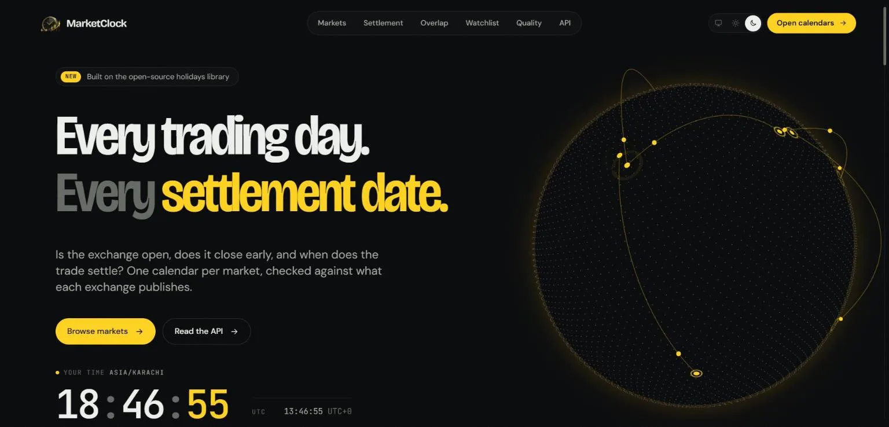
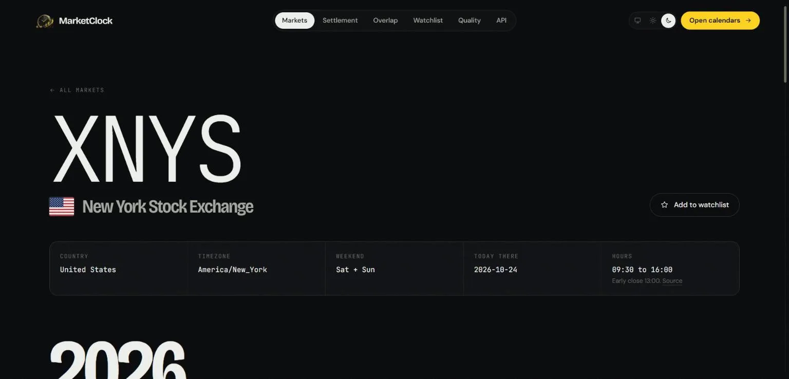
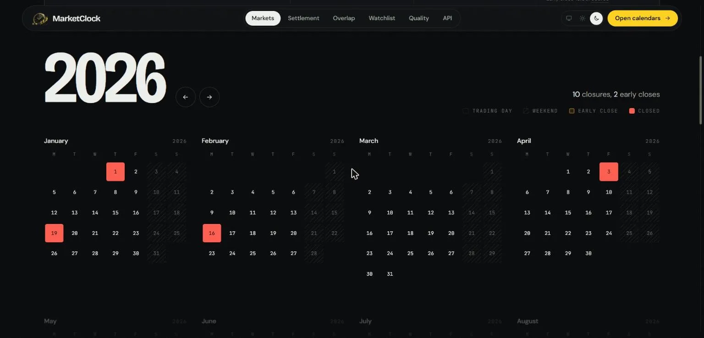
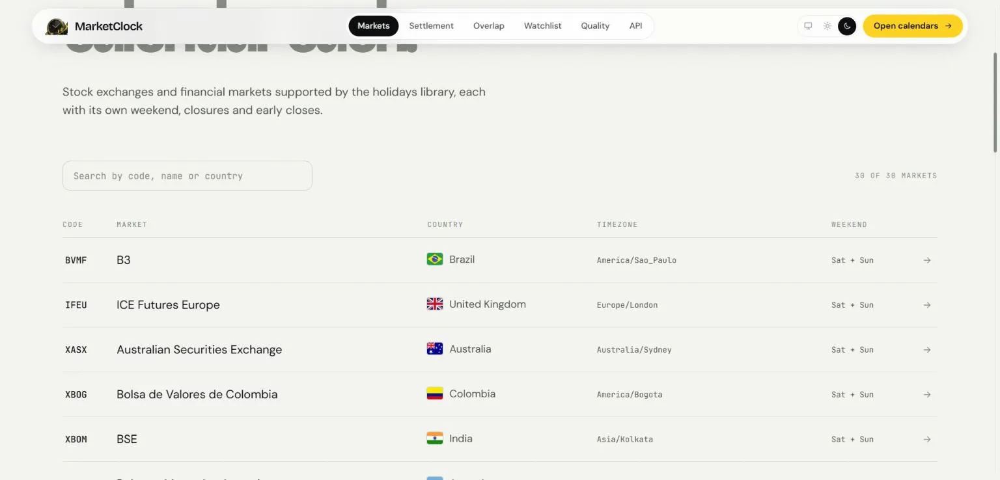
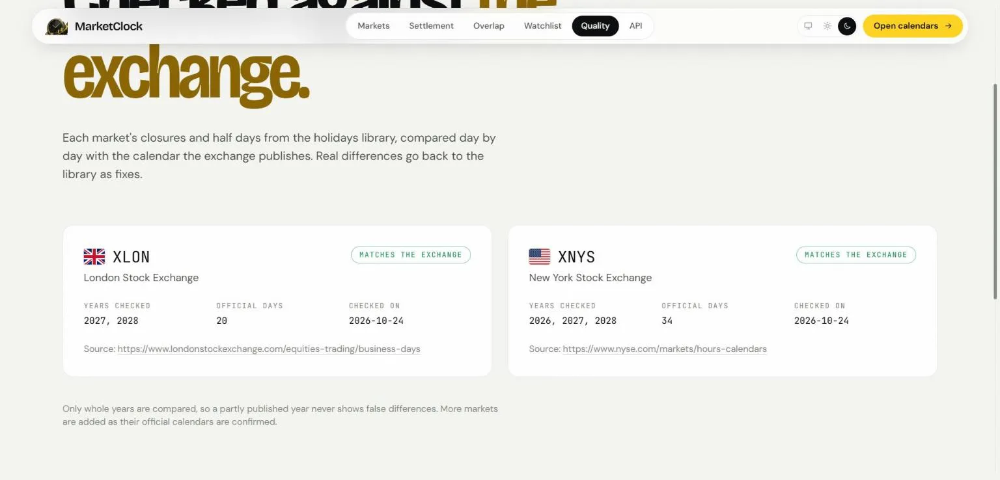
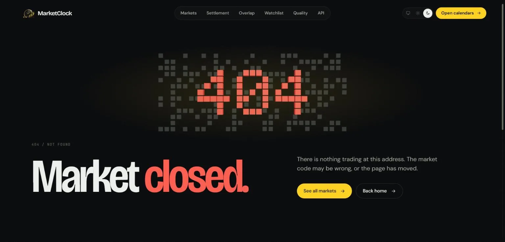
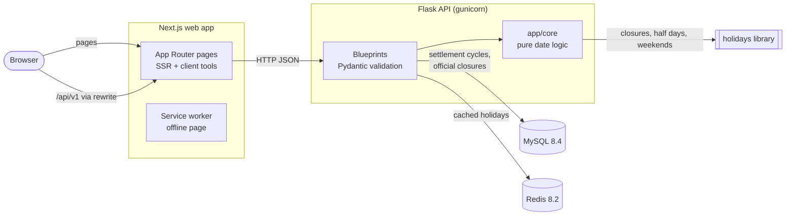
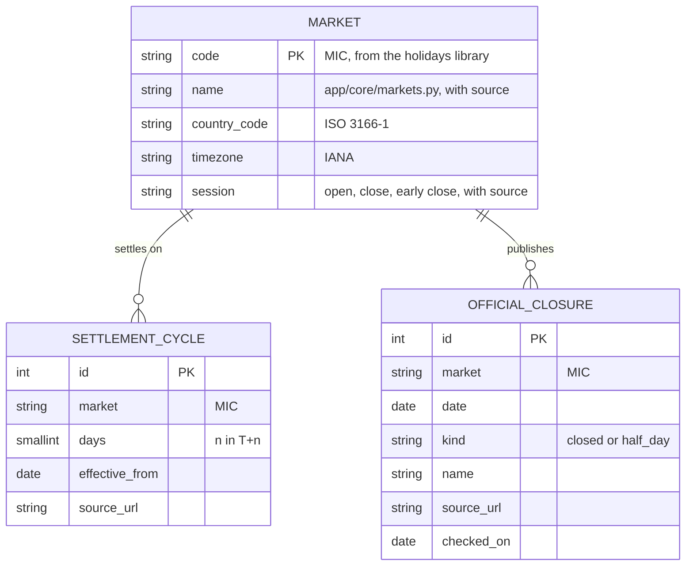
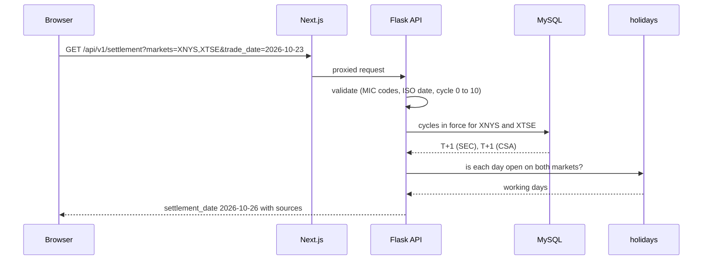

<p align="center">
  
</p>

<h1 align="center">MarketClock</h1>

<p align="center"><strong>Every trading day, every settlement date.</strong></p>

<p align="center">
  <a href="https://github.com/ahmershahdev/marketclock/actions/workflows/backend.yml"></a>
  <a href="https://github.com/ahmershahdev/marketclock/actions/workflows/frontend.yml"></a>
  <a href="https://github.com/ahmershahdev/marketclock/actions/workflows/images.yml"></a>
  <a href="https://github.com/ahmershahdev/marketclock/actions/workflows/codeql.yml"></a>
</p>

MarketClock answers the questions a trading desk or back office asks every day: is this exchange
open today, does it close early, and when does a trade settle? It covers the 30 stock exchanges
and financial markets in the Python [holidays](https://github.com/vacanza/holidays) library
(NYSE, Nasdaq, LSE, PSX, Tadawul, HKEX, JPX and more) through a REST API, a web app and public
calendar pages, and it checks the library's dates against what each exchange publishes.

> **Status:** feature-complete for launch. Milestones M1 to M5 are done; M6 (deploy to
> `marketclock.ahmershah.dev`) is planned for February 2027. See
> [docs/roadmap.md](docs/roadmap.md) and [docs/status.md](docs/status.md).

## Screenshots

| | |
|---|---|
|  |  |
| **Home.** 3D globe of exchange cities, live clocks. | **Market page.** Country, timezone, weekend, hours with source. |
|  |  |
| **Year calendar.** Closures, early closes and weekends. | **Markets.** All 30 markets, searchable, light theme. |
|  |  |
| **Data quality.** Library dates checked against the exchange. | **404.** The code spelled in 3D calendar tiles. |

## Features

**Calendars**
- Closures and half days for every market and year the library covers, with names in English.
- Open right now: each market's state with a countdown to the close or open, in exchange time.
  Weekends and holidays work for all 30 markets; hours need a session on file.
- Calendar subscriptions: an iCalendar feed per market for Google Calendar, Apple Calendar and
  Outlook, rolling over to cover this year and next.
- Is a date a trading day, the next and previous trading day, and every trading day in a range,
  each market with its own weekend (Friday and Saturday for Tadawul).
- Session hours and early-close times with their source (NYSE, Nasdaq, JPX, HKEX, ASX, LSE).
- A page per market and year (`/markets/XNYS/2027`) and a yearly index of every market
  (`/holidays/2027`), each with its own title and canonical URL.

**Settlement and overlap**
- T+0 to T+10 settlement dates across up to 10 markets, counted only on days when every market
  is open.
- Settlement cycles stored with their effective date and regulator source (US T+2 from 2017 and
  T+1 from 2024, Canada T+1 from 2024, UK T+1 from October 2027). Leave the cycle out and the
  one in force on the trade date is used and linked.
- Days in a range when several markets all trade.

**Data quality**
- Each exchange's published calendar stored with its source and check date, compared day by day
  with the library. NYSE (2026 to 2028), Nasdaq (2026) and LSE (2027 and 2028) match exactly.

**Web app**
- Markets list with flags, per-market year calendars, settlement and overlap tools, a browser-only
  watchlist (no accounts), data-quality page and API reference.
- Light, dark and system themes, themed scrollbars and dropdowns, custom scroll rail, 3D globe,
  3D 404 and error pages, CSS 3D offline page served by a service worker.
- One broken widget never takes a page down: 3D scenes and demos fail on their own, page errors
  keep the header and footer.
- `robots.txt`, `sitemap.xml`, `llms.txt`, `llms-full.txt`, Open Graph image, titles and
  descriptions on every page.

**Engineering**
- Pure date logic in `backend/app/core` with 100% branch coverage, tests against real MySQL.
- OpenAPI schema generated from the Pydantic models; the web app's types are generated from it
  and CI fails when either drifts.
- Holidays cached in Redis per library version, market and year; an outage only skips the cache.

## API

Base URL `/api/v1`, JSON only, read-only. Full schema at
[`/api/v1/openapi.json`](backend/openapi.json).

| Endpoint | Query | Answer |
|---|---|---|
| `GET /markets` | | every market with country, flag code, timezone, weekend, session |
| `GET /markets/{code}` | | one market |
| `GET /markets/{code}/holidays` | `year` | closures and half days with names and close times |
| `GET /markets/{code}/status` | `at`? | open, closed or hours unknown, with the next close or open |
| `GET /status` | `at`? | the same for every market |
| `GET /markets/{code}/calendar.ics` | `year`? | iCalendar feed: this year and next, or one year |
| `GET /markets/{code}/is-trading-day` | `date` | true or false |
| `GET /markets/{code}/next-trading-day` | `date` | first trading day after the date |
| `GET /markets/{code}/previous-trading-day` | `date` | last trading day before the date |
| `GET /markets/{code}/trading-days` | `start`, `end` | trading days in the range (at most 400 days) |
| `GET /markets/{code}/settlement-cycle` | `date` | cycle in force with its source, or null |
| `GET /settlement` | `markets`, `trade_date`, `cycle`? | settlement date on every listed market |
| `GET /overlap` | `markets`, `start`, `end` | days on which every market trades |
| `GET /data-quality` | | library compared with official calendars |
| `GET /health` | | MySQL and Redis status (503 when either is down) |

```bash
curl "http://localhost:5000/api/v1/settlement?markets=XNYS,XLON&trade_date=2026-12-23&cycle=2"
# {"markets":["XNYS","XLON"],"trade_date":"2026-12-23","cycle":2,"settlement_date":"2026-12-29",...}
```

Every error has one shape: `{"error": {"code", "message", "params"}}`.

## Architecture



The web app only talks to the API, and the API is the only part that talks to MySQL and Redis.
Holiday dates are never copied: the library is the single source, and the `official_closure`
table exists only to check it.

### Data model



`MARKET` is not a table: codes, weekends and holidays come from the library, and name, country,
timezone and sessions are reviewed constants in code. The two tables are created by Alembic and
filled by `flask --app wsgi seed`, which only holds rows whose source page was read.

### A settlement request



## Tech stack

| Layer | Tools |
|---|---|
| API | Python 3.12, Flask 3.1, Pydantic 2.14, SQLAlchemy 2.1, Alembic 1.20, PyMySQL, gunicorn 26, tzdata |
| Data | `holidays` 0.107 (exact pin), MySQL 8.4 LTS (utf8mb4), Redis 8.2 |
| Web | Next.js 16.4 (App Router, Cache Components), React 19.3, TypeScript 5.9 strict, Tailwind CSS 4.3, three.js 0.186 with React Three Fiber |
| Contract | OpenAPI 3.1 from Pydantic, `openapi-typescript` for the web app's types |
| Quality | pytest (100% branch coverage), Vitest, Ruff, mypy strict, ESLint, Prettier, CodeQL |
| Delivery | Docker (multi-stage, non-root), Docker Compose for dev and prod, GitHub Actions, Dependabot |

## Run locally

Needs Docker, Python 3.12 and Node 22.

```bash
cp .env.example .env                              # set your own passwords
docker compose up -d                              # MySQL, Redis and the API on :5000
docker compose exec api alembic upgrade head      # tables
docker compose exec api flask --app wsgi seed     # sourced settlement cycles and calendars

cd frontend
npm install
npm run dev                                       # web app on http://localhost:3000
```

### Tests and linters

```bash
cd backend                        # Windows paths; on macOS or Linux use .venv/bin/
py -3.12 -m venv .venv
.venv/Scripts/pip install -r requirements-dev.txt
.venv/Scripts/pytest              # needs the Compose MySQL and TEST_DATABASE_URL from .env
.venv/Scripts/ruff check . && .venv/Scripts/ruff format --check . && .venv/Scripts/mypy

cd ../frontend
npm run lint && npm run typecheck && npm test && npm run build
```

After changing an API model, regenerate the schema and the web app's types in the same PR:

```bash
cd backend && .venv/Scripts/python write_openapi.py
cd ../frontend && npm run api:types
```

### Production

```bash
docker compose -f compose.prod.yaml up -d --build
```

The API container migrates, seeds and starts gunicorn; the web app runs as a Next.js standalone
server. Both are published on `127.0.0.1` for a reverse proxy. Full steps in
[docs/deploy.md](docs/deploy.md).

### Lighthouse

Measured locally against the production images (`compose.prod.yaml`) with Lighthouse 13, on
2026-10-24. Final scores come from the live server after the February deploy.

| Page | Desktop (perf / a11y / best / SEO) | Mobile (perf / a11y / best / SEO) |
|---|---|---|
| `/` | 76 / 100 / 100 / 100 | 60 / 100 / 100 / 100 |
| `/markets` | 95 / 100 / 100 / 100 | 73 / 100 / 100 / 100 |
| `/markets/XNYS` | 96 / 100 / 100 / 92 | 56 / 100 / 100 / 92 |
| `/data-quality` | 95 / 100 / 100 / 100 | 50 / 100 / 100 / 100 |
| `/tools/settlement` | 97 / 100 / 100 / 100 | 54 / 100 / 100 / 100 |

Mobile performance runs on a throttled CPU and network and varied by up to 30 points between
identical runs on the development machine.

## Project layout

```
backend/app/core/    pure date logic: calendar, settlement, data quality, market details
backend/app/api/     Flask blueprints
backend/app/         app factory, config, models, schemas, OpenAPI, cache, seed data
backend/migrations/  Alembic
backend/tests/       pytest against MySQL, mirrors app/
frontend/src/app/    Next.js routes, robots, sitemap, llms files, error and offline pages
frontend/src/        components and lib (API client, generated schema types, calendar maths)
docs/                roadmap, architecture, status, deploy guide, screenshots
compose.yaml         local stack; compose.prod.yaml for the server
```

## Milestones

| Milestone | State |
|---|---|
| M1 Skeleton | done |
| M2 Core API | done; session hours on file for 6 markets |
| M3 Settlement | done; cycles on file for 4 markets |
| M4 Web app | done |
| M5 Data quality | done for NYSE, Nasdaq and LSE; no differences to report upstream yet |
| M6 Docs and launch | production setup and README done; deploy and Lighthouse in February 2027 |

## Documentation

- [docs/roadmap.md](docs/roadmap.md): milestones and what "done" means
- [docs/architecture.md](docs/architecture.md): API rules, data sources and every decision
- [docs/deploy.md](docs/deploy.md): server setup, reverse proxy and updates
- [docs/status.md](docs/status.md): current state, updated every session
- [CONTRIBUTING.md](CONTRIBUTING.md) and [SECURITY.md](SECURITY.md)

## Related

- [HolidayOps](https://github.com/ahmershahdev/holidayops): business-day calendars for countries
  and companies, built on the same library.

## Contact

- Email: [support@ahmershah.dev](mailto:support@ahmershah.dev) (security reports: see
  [SECURITY.md](SECURITY.md))
- LinkedIn: [syedahmershah](https://www.linkedin.com/in/syedahmershah)
- Website: [ahmershah.dev](https://ahmershah.dev)

## License

[MIT](LICENSE). Holiday data comes from the `holidays` library (MIT). Country flags are from
[flag-icons](https://github.com/lipis/flag-icons) (MIT, licence in `frontend/public/flags`).

Built by [Syed Ahmer Shah](https://ahmershah.dev).
